<p align="center">
  
</p>

<h1 align="center">Forever STUwave</h1>

<p align="center">
  A neon arcade UI for WoW Forever.<br>
  <strong>Beta · WoW Forever interface 16001 · 16:9</strong>
</p>

<p align="center">
  <a href="#install">Install</a> ·
  <a href="#whats-in-it">What's in it</a> ·
  <a href="#class-modules">Class modules</a> ·
  <a href="#screenshots">Screenshots</a> ·
  <a href="#update">Update</a> ·
  <a href="#help-shape-it">Help shape it</a> ·
  <a href="docs/DEVELOPMENT.md">Development</a>
</p>

<p align="center">
  <a href="https://github.com/ironmoose/forever-stuwave/releases/download/v1.0.0-beta.5.2/ForeverSTUwave-1.0.0-beta.5.2.zip">
    
  </a>
</p>

<p align="center">
  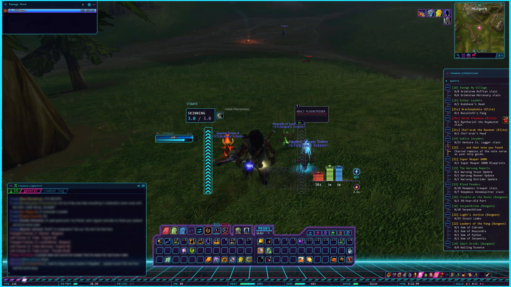
</p>

## Install

1. **Close WoW.**
2. [Download the addon ZIP](https://github.com/ironmoose/forever-stuwave/releases/download/v1.0.0-beta.5.2/ForeverSTUwave-1.0.0-beta.5.2.zip) and extract it.
3. Put its `forever-stuwave/` folder into `_forever_/Interface/AddOns/`. Keep its name unchanged.
4. Start WoW and enable **Forever STUwave** in the AddOns menu.

> **Existing install?** Use the [deployment script](docs/DEVELOPMENT.md#deploying-a-development-build) to migrate settings and retire the old copy.

<details>
<summary>Install from Git</summary>

Clone outside your game folder:

```sh
git clone https://github.com/ironmoose/forever-stuwave.git
```

Copy the inner `forever-stuwave/` folder into `Interface/AddOns/`, or use the [deployment script](docs/DEVELOPMENT.md#deploying-a-development-build).

</details>

## What's in it

### Only in STUwave

- **The Gunsight:** your combat HUD wrapped around your character. Your health and power, your target's, cast bars, DoTs, procs and your class module, right where your eyes already are.
- **A moving pixel art module for every class:** shout helms for Warriors, a seal and a slamming hammer for Paladins, totem poles for Shamans, a scope for Hunters, a demon's spellbook for Warlocks, and more. The Help page shows what every part means.
- **Quick keys over your action bars:** one click shows or hides your cast bar, your target's cast bar, procs, buff reminders, party frames, the quest tracker and chat.
- **Mana regen timer:** an LED panel that counts down five seconds after you spend mana, then flips to REGEN.
- **Class tabs:** Shaman weapon imbue and shield tiles you click to cast, a Warrior Thunder Clap tab, and an ammo counter for bows, crossbows and guns. Want something special for your class? Drop us a comment, dude.
- **Data bar:** time, gold on all your characters, rested XP, FPS, latency, durability and free bag slots.
- **Quest mob marker:** an amber "!" on every mob your quests need, even the ones the game forgets to mark.
- **Reapply reminders:** a debuff that falls off your target stays as a red tile until you put it back.
- **Stun alert and quest timers:** stuns, fears and silences snap onto the Gunsight with a countdown ring, and quest timers glow under the minimap.

<p align="center">
  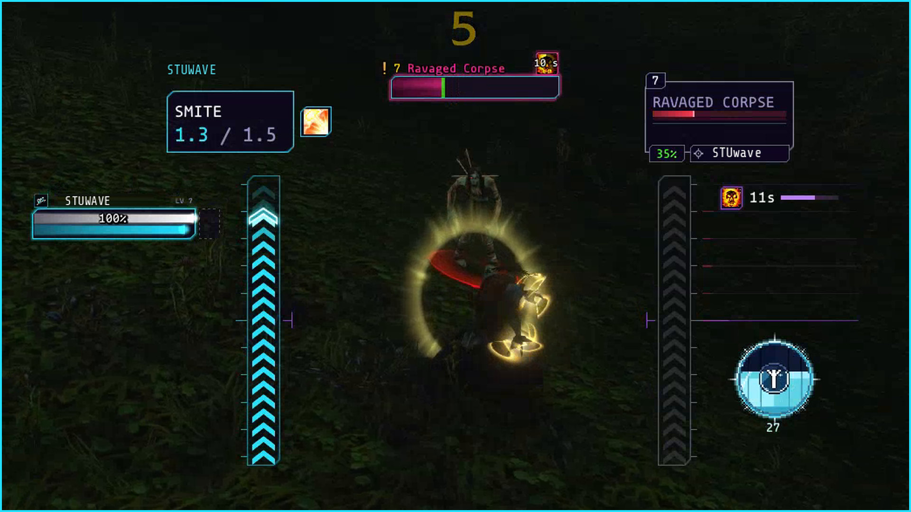
  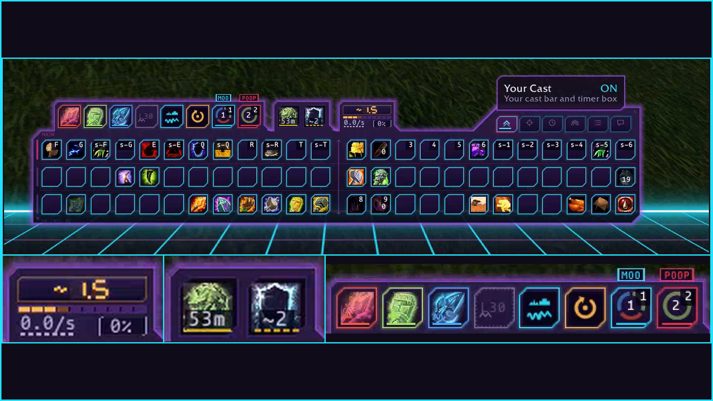
</p>

### Everything else

Unit frames, party and raid frames, nameplates, action bars, bags and bank, chat, the minimap, the character window, talents with a moving scene behind every tree, and the STUwave look on mail, vendors, the auction house, quests, trainers, professions, the world map and more. Mail even fills in the subject for you. Sweet!

### Supported addons

- **[Questie](https://www.curseforge.com/wow/addons/questie):** its tracker and quest icons wear the STUwave look.
- **[Auctionator](https://www.curseforge.com/wow/addons/auctionator):** its auction house tabs and buy windows too.

### Getting started

1. Type **/fsconfig** (or click the STU key on the minimap) for settings. The **Help** page explains every class module.
2. Type **/fsedit** to move things around.

<p align="center">
  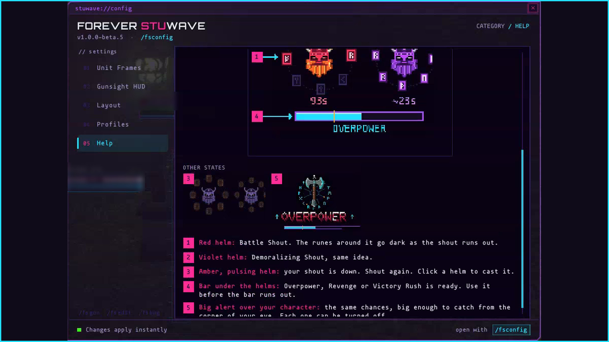
  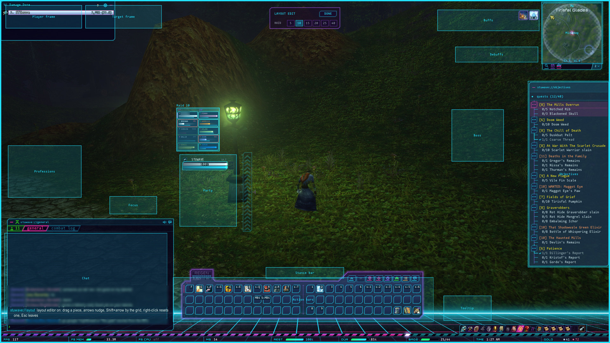
</p>

## Class modules

Every class gets a moving pixel art module beside the Gunsight. Open a class to see what each part means; the same pictures and lines are on the in-game Help page.

<p align="center">
  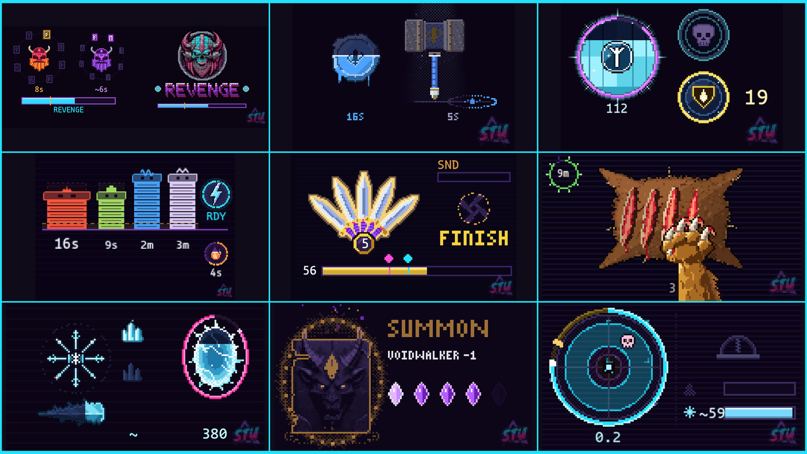
  <br>
  <sub>Warrior, Paladin, Priest / Shaman, Rogue, Druid (Cat) / Mage (Frost), Warlock, Hunter</sub>
</p>

<details>
<summary><strong>Warrior</strong>: Two Viking helms that yell for you. Bodacious.</summary>

<p>
  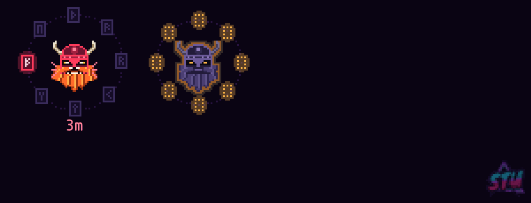
  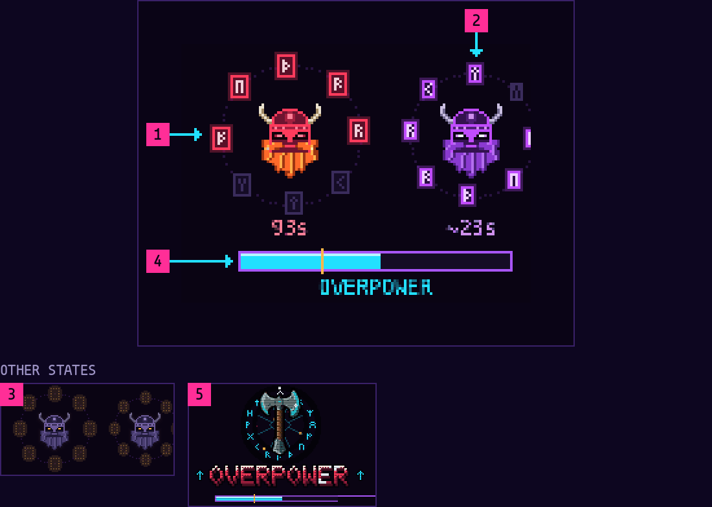
</p>

1. **Red helm:** Battle Shout. The runes around it go dark as the shout runs out.
2. **Violet helm:** Demoralizing Shout, same idea.
3. **Amber, pulsing helm:** your shout is down. Shout again. Click a helm to cast it.
4. **Bar under the helms:** Overpower, Revenge or Victory Rush is ready. Use it before the bar runs out.
5. **Big alert over your character:** the same chances, big enough to catch from the corner of your eye. Each one can be turned off.

</details>

<details>
<summary><strong>Paladin</strong>: A wax seal and a hammer that slams. Righteous.</summary>

<p>
  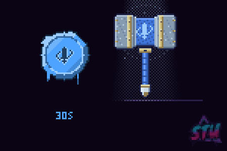
  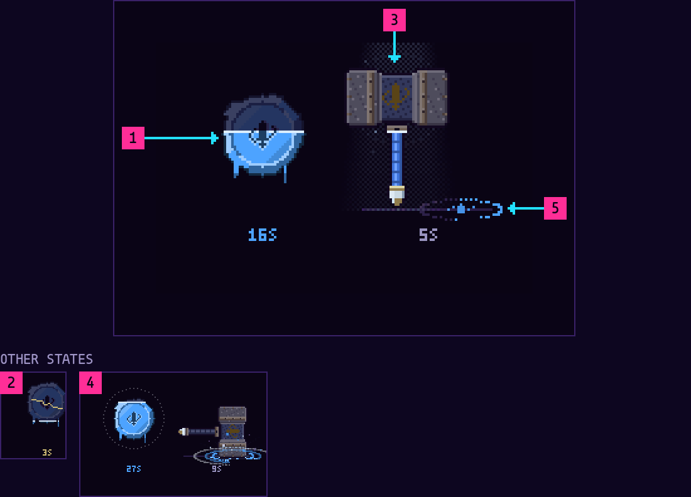
</p>

1. **Wax seal:** your seal. The color tells you which one, and the wax drains as it runs out.
2. **Cracked amber seal:** about to drop. Recast it.
3. **Warhammer:** Judgement. It fills up as the cooldown comes back and glows when ready.
4. **The slam:** cast Judgement and the hammer smashes down.
5. **Rune on the ground:** the Judgement on your target and how long it has left.

</details>

<details>
<summary><strong>Priest</strong>: A glowing shield and two medallions.</summary>

<p>
  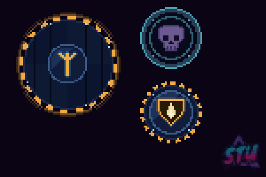
  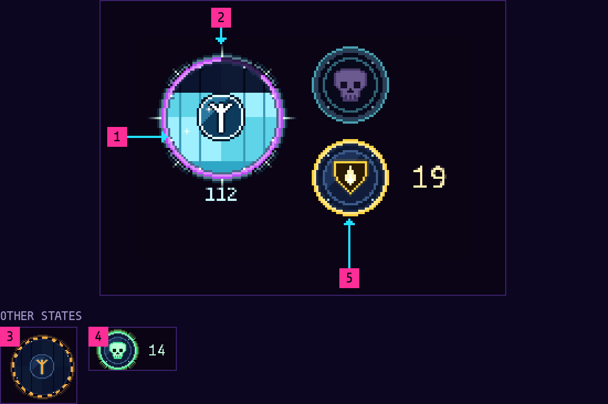
</p>

1. **Shield:** Power Word: Shield on your friendly target, or on you. The light inside is how much it can still absorb, and the number is the amount.
2. **Shield rim:** violet means Weakened Soul, cyan means you can shield again.
3. **Amber dashed shield in a fight:** nobody has a shield. Put one up.
4. **Skull:** Spirit Tap after a kill, with its time. Pull the next mob while it lasts.
5. **Gold flame:** Inner Fire and its charges. It pulses amber when it is missing.
In a group the right side can show Prayer of Mending instead. Pick it under Right side shows.

</details>

<details>
<summary><strong>Shaman</strong>: Four totem poles and two discs. Gnarly.</summary>

<p>
  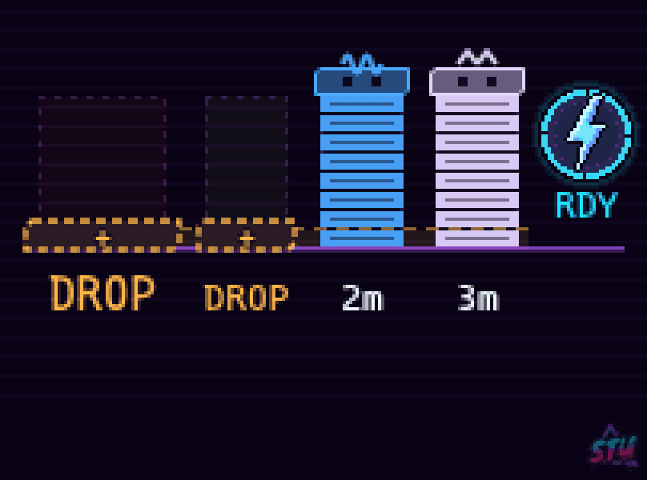
  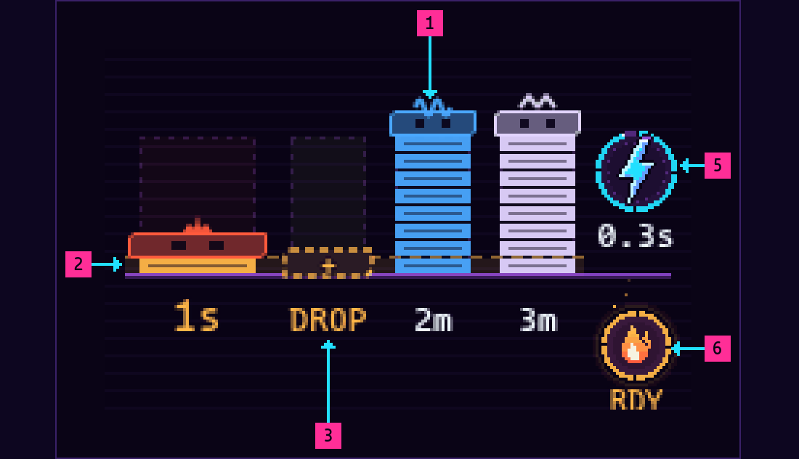
</p>

1. **Four totem poles:** Fire, Earth, Water and Air. The pole shrinks as your totem runs out.
2. **Amber top block:** your totem is nearly gone. Drop it again.
3. **DROP:** no totem in that element. Click the pole to drop one.
4. **FAR:** you walked away from your totem.
5. **Lightning disc:** your shock cooldown. RDY means shock now.
6. **Flame disc:** Fire Nova, shown while you have a Fire totem down.

</details>

<details>
<summary><strong>Rogue</strong>: A fan of daggers that fills up as you build. Sneaky and sweet.</summary>

<p>
  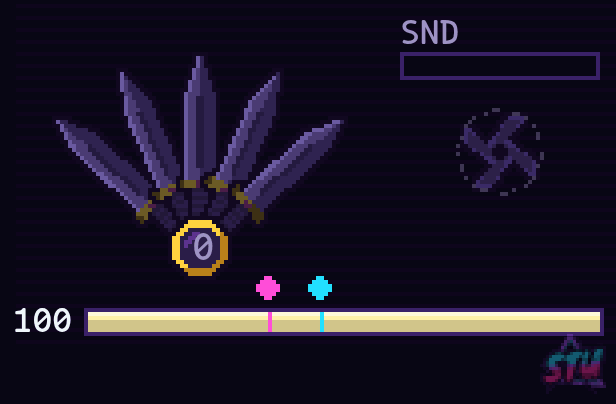
  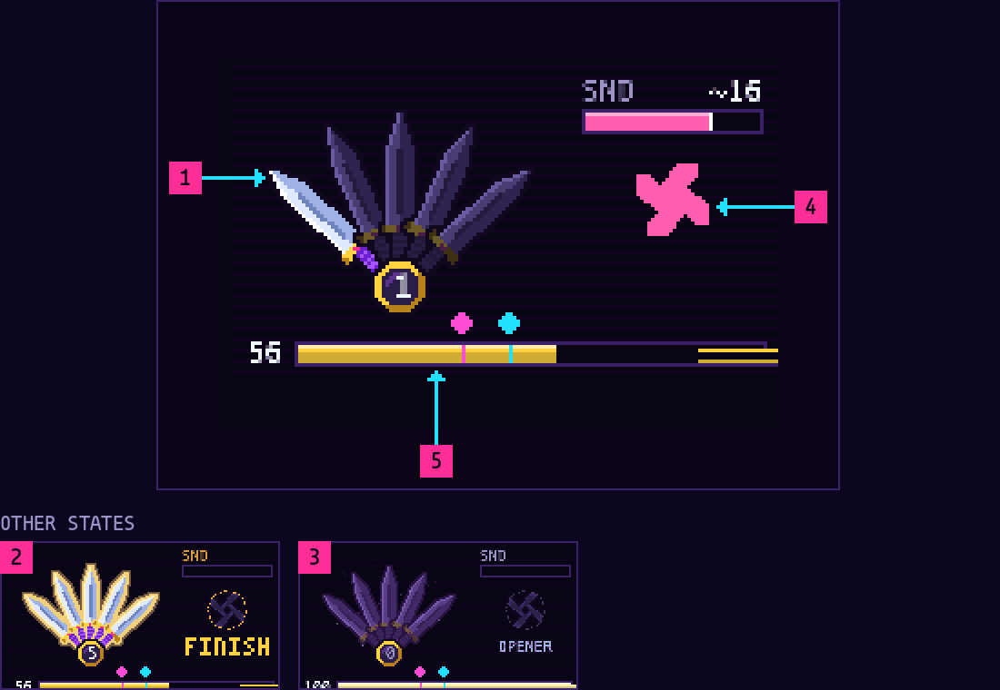
</p>

1. **Dagger fan:** your combo points, one dagger per point.
2. **Gold fan and FINISH:** five points. Spend them.
3. **Shadow fan and OPENER:** you are in stealth.
4. **Spinning star:** Slice and Dice and its time. It pulses amber in a fight when it is down.
5. **Gold bar:** your energy. The two gems light up when you can afford your builder and your finisher.

</details>

<details>
<summary><strong>Druid</strong>: One look for every form. Shape shifting is totally rad.</summary>

#### Caster form

<p>
  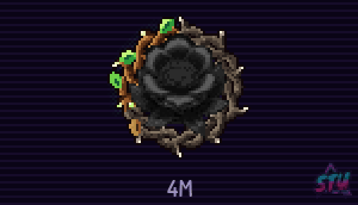
  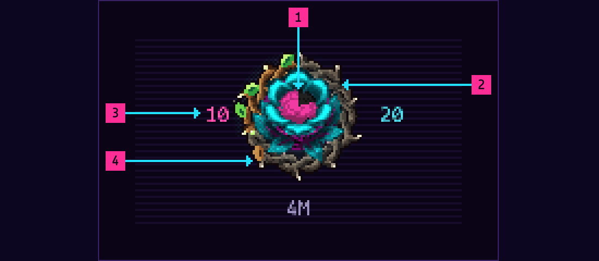
</p>

1. **Rose:** Rejuvenation. It greys out as the time runs down.
2. **Seven petals:** Regrowth. One petal wilts each time it heals.
3. **Pink and teal numbers:** time left on Rejuvenation and Regrowth.
4. **Bramble wreath:** your Thorns time. It dries out as Thorns runs down and drops a leaf every minute.

#### Bear form

<p>
  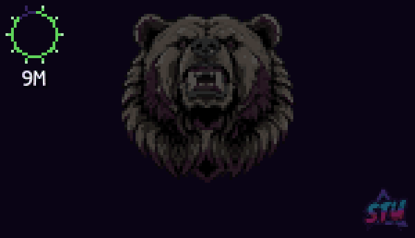
  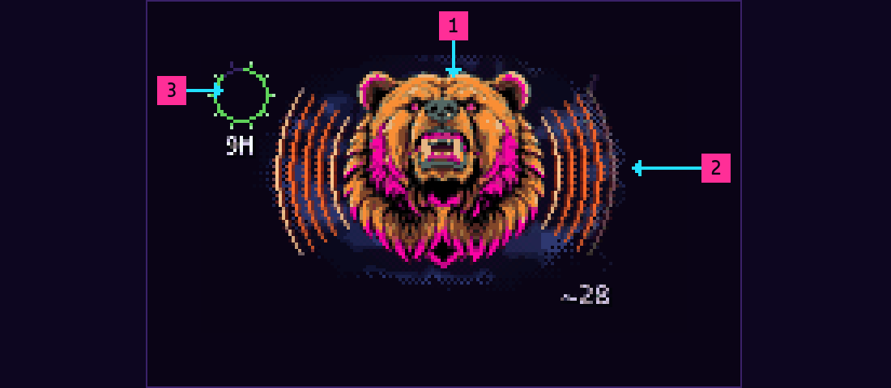
</p>

1. **Bear head:** Demoralizing Roar. Bright and snarling while it is on the enemies, grey when it is not.
2. **Sound arcs:** the roar's time, turning amber near the end.
3. **Ring of thorns:** your Thorns time.

#### Cat form

<p>
  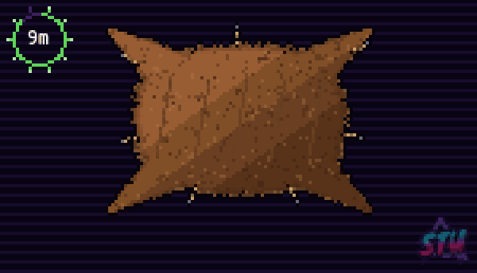
  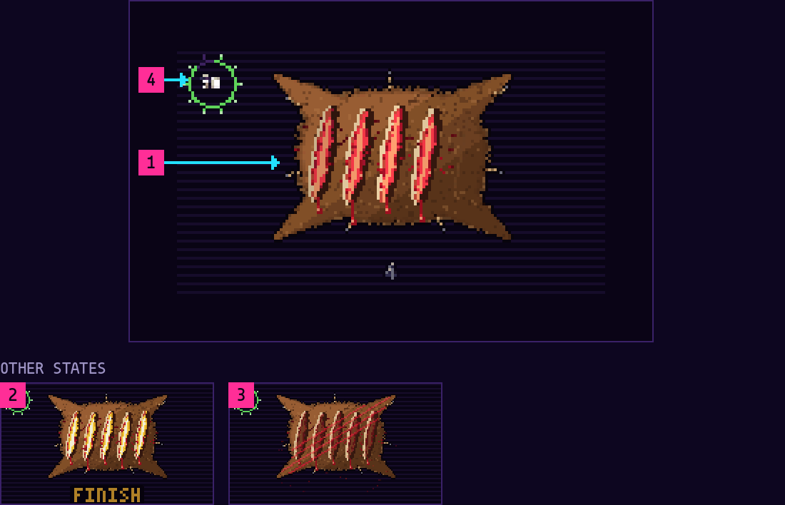
</p>

1. **Hide with five slots:** your combo points. The paw rakes a gash for each one.
2. **Gold gashes and FINISH:** five points. Spend them.
3. **The finisher:** the paw swipes across the hide.
4. **Ring of thorns:** your Thorns time.

</details>

<details>
<summary><strong>Mage</strong>: A different piece for Frost, Arcane and Fire. Wicked. You see the one for your spec.</summary>

#### Frost

<p>
  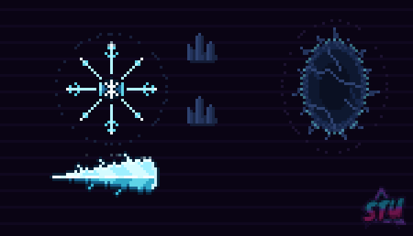
  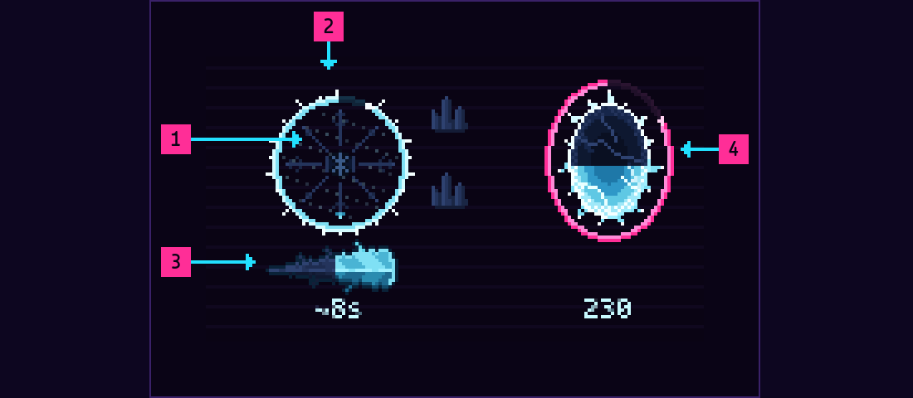
</p>

1. **Snowflake:** Frost Nova. The ring around it fills back up as the cooldown comes back.
2. **Ice ring:** your target is frozen, and the time under it is about how long.
3. **Ice spike:** Ice Lance. It shines when it hits hardest.
4. **Ice oval:** Ice Barrier and how much it can still absorb. Click it to cast.

#### Arcane

<p>
  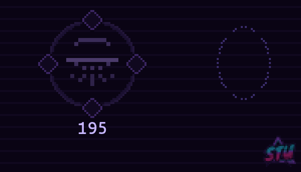
  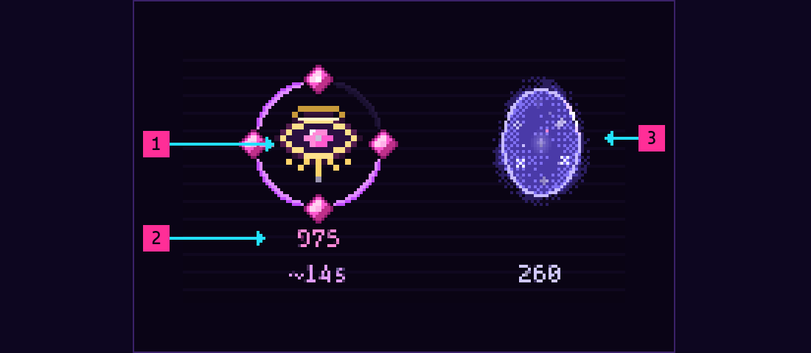
</p>

1. **Eye:** opens wider as Arcane Blast stacks up, with the time the stacks have left.
2. **Number under the eye:** what your next Blast costs.
3. **Purple oval:** Mana Shield and how much it can still absorb. Click it to cast.

#### Fire

<p>
  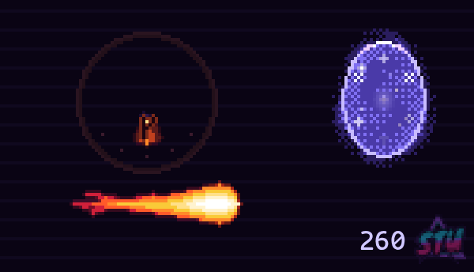
  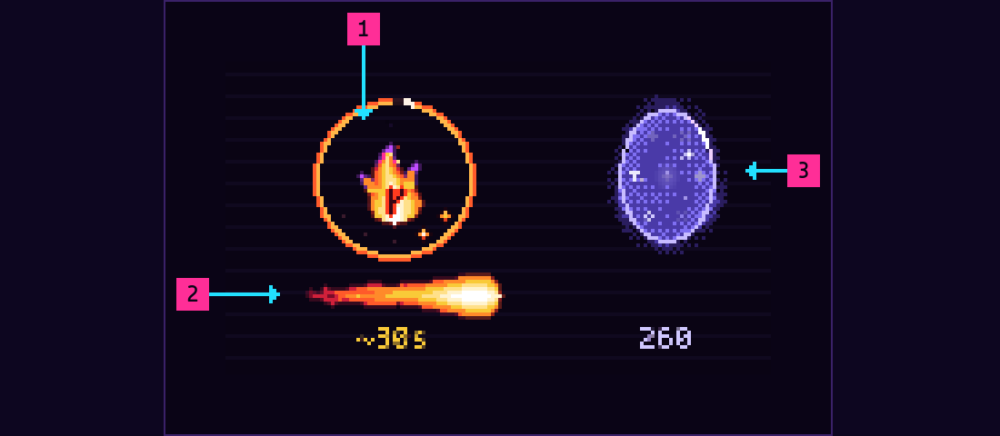
</p>

1. **Flame:** grows with your Fire Vulnerability stacks on the target, with their time.
2. **Comet:** Fire Blast. Bright when it is ready, dark while it cools.
3. **Purple oval:** Mana Shield and how much it can still absorb. Click it to cast.

</details>

<details>
<summary><strong>Warlock</strong>: Your demon's spellbook, and it talks back. Spooky, dude.</summary>

<p>
  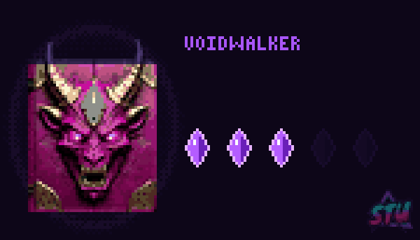
  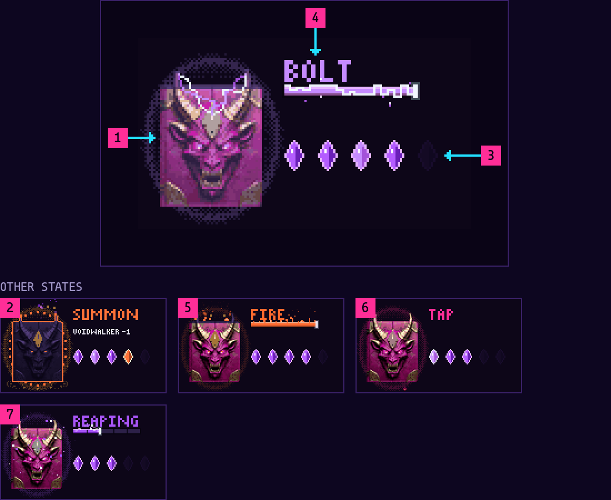
</p>

1. **The book:** your demon's pact book. The cover lights up from the bottom with your demon's health.
2. **Dark, smoking book:** your demon is gone. SUMMON names the demon and what it costs.
3. **Five crystals:** your soul shards, one per crystal. +2 means you carry two more.
4. **Lightning into the gem:** BOLT, your next Shadow Bolt is instant.
5. **Burning pages:** FIRE, Soul Fire is free and fast.
6. **Blood dripping:** TAP, use Life Tap before your next Shadow Bolt.
7. **Souls flying into the book:** REAPING, keep channeling Drain Soul.
Each prompt can be turned off on the Gunsight HUD page.

</details>

<details>
<summary><strong>Hunter</strong>: A scope that tells you when to chill and stand still.</summary>

<p>
  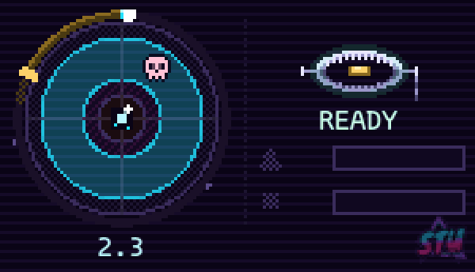
  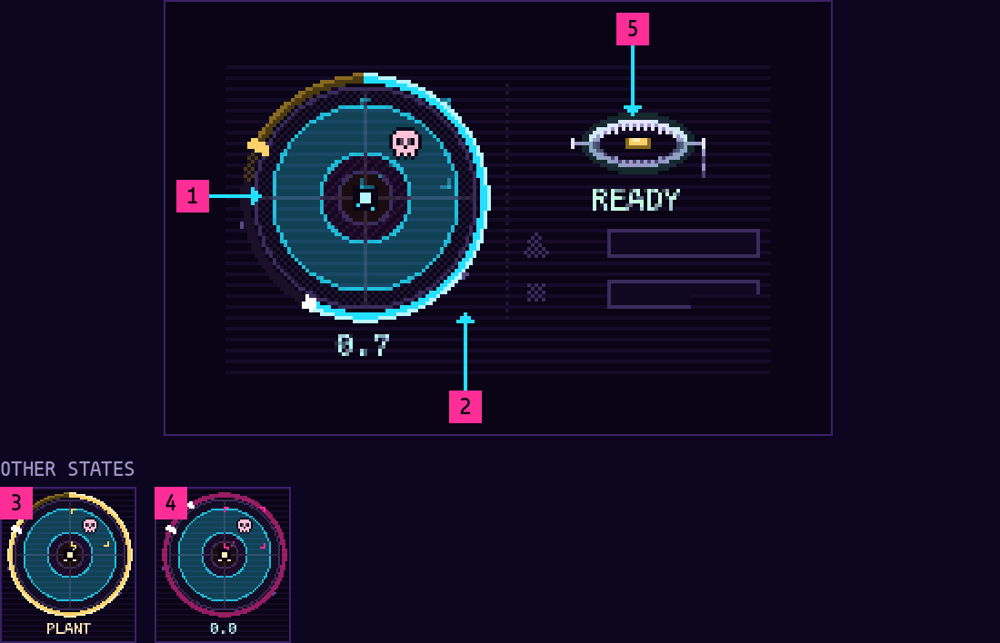
</p>

1. **Scope:** you are the dot, the skull is your target. The rings show melee, dead zone, shooting range and too far.
2. **Rim:** your Auto Shot timer. Walk while it fills.
3. **PLANT:** stand still, the shot is coming.
4. **Pink rim:** you moved and the shot was late.
5. **Jaws:** your traps. Open and READY means you can lay one.

</details>


## Screenshots

<table>
  <tr><td width="50%" align="center">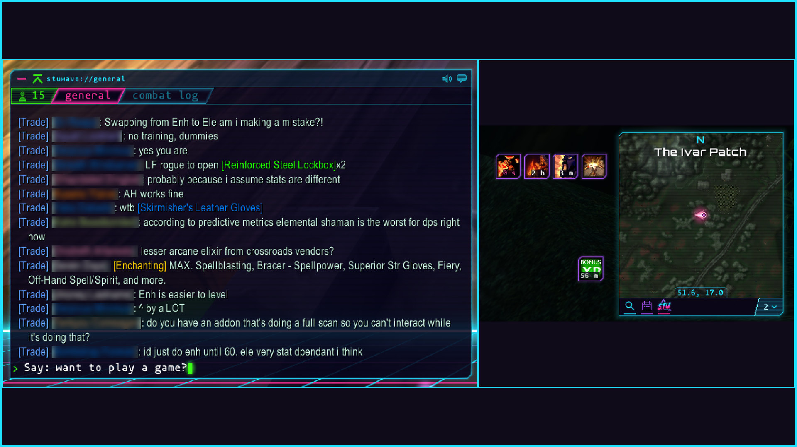<br><sub>Chat, minimap and buffs</sub></td><td width="50%" align="center">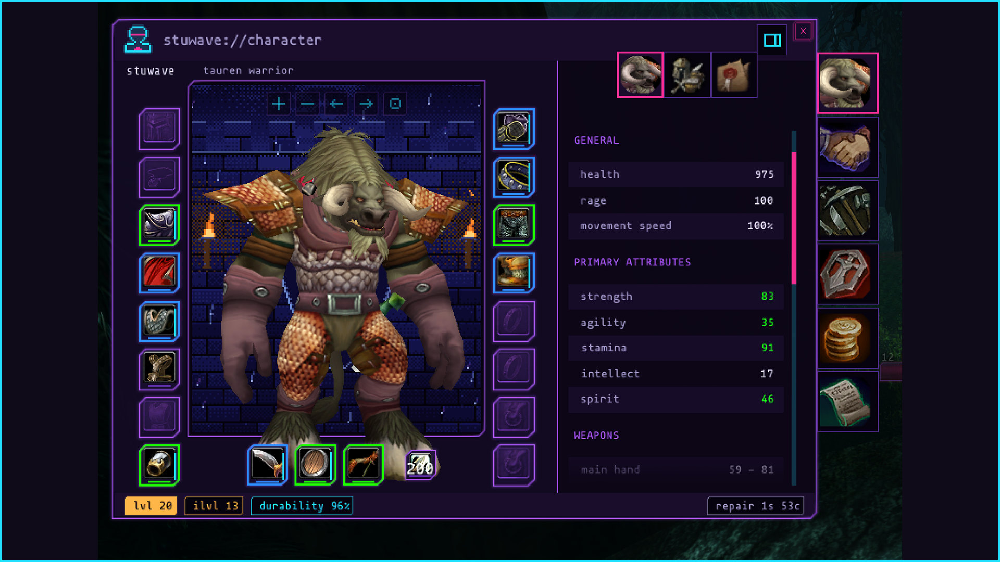<br><sub>The character window</sub></td></tr>
  <tr><td width="50%" align="center">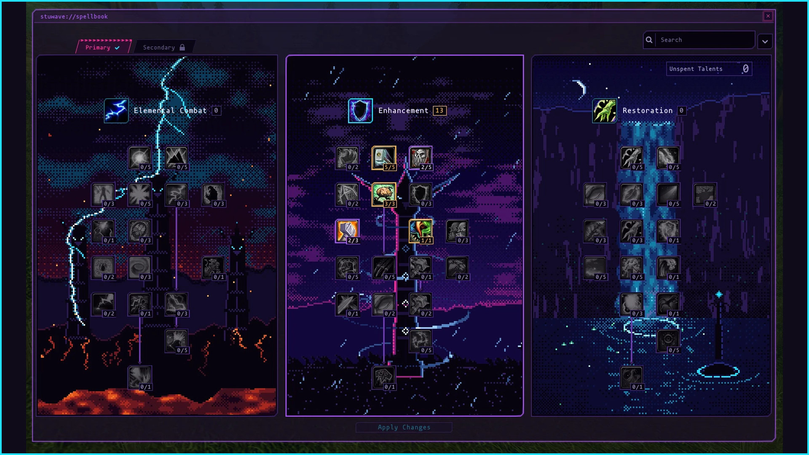<br><sub>Talents with a moving scene behind each tree</sub></td><td width="50%" align="center">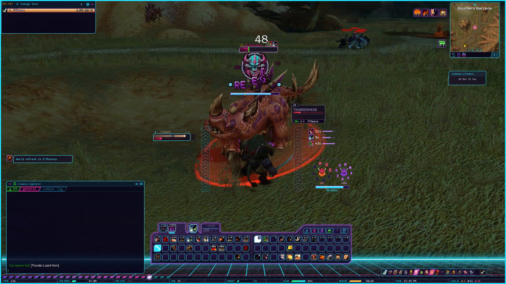<br><sub>A Warrior in a fight</sub></td></tr>
  <tr><td width="50%" align="center">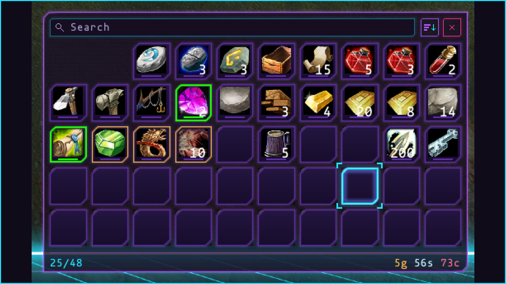<br><sub>Bags</sub></td><td width="50%" align="center">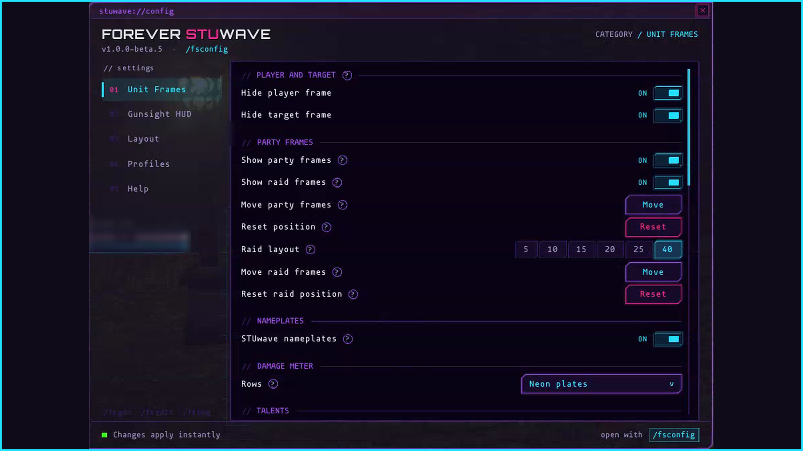<br><sub>Settings (/fsconfig)</sub></td></tr>
</table>

## Update

1. **Close WoW** and download the new addon ZIP from [Releases](https://github.com/ironmoose/forever-stuwave/releases).
2. Replace the installed `forever-stuwave/` folder with the one from the ZIP.
3. **Fully restart WoW.**

For a Git install, run `git pull --ff-only` in your checkout and repeat the copy or deployment.

## Help shape it

### Report a bug

1. Describe the problem in game:

   ```text
   /fsbug what went wrong
   ```

2. Copy the report that opens. It includes your **class, level, addon settings, and recent errors**.
3. Review it, then paste it into a [new bug report](https://github.com/ironmoose/forever-stuwave/issues/new). Add a screenshot if the problem is visual.

### Suggest an improvement

[Share your idea](https://github.com/ironmoose/forever-stuwave/issues/new). Tell us what you'd like to change and why.

---

[Testing guide](docs/TESTING.md) · [Development](docs/DEVELOPMENT.md) · [MIT license](LICENSE) · [Third party notices](docs/THIRD_PARTY_NOTICES.md)
